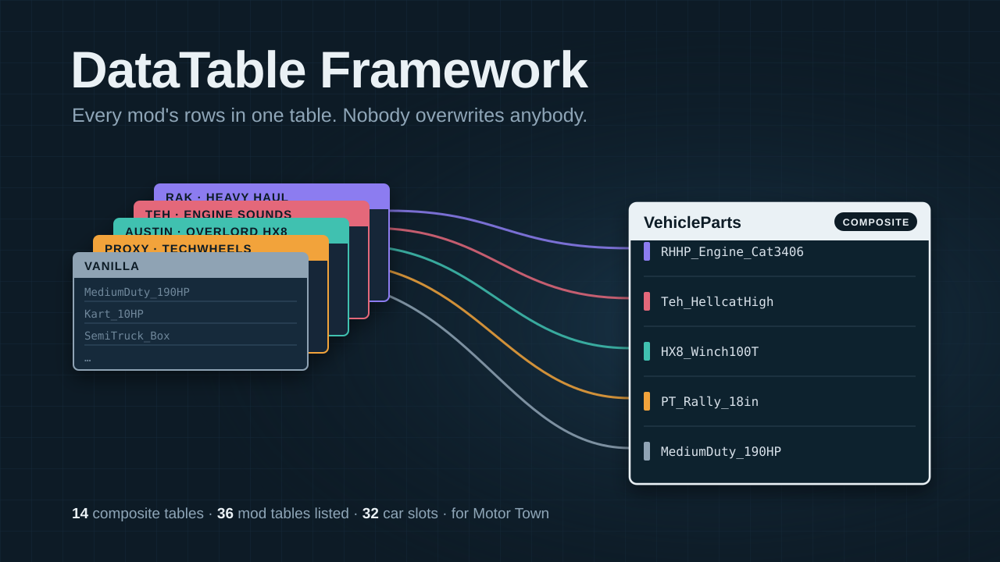

# DataTable Framework



**Lets every Motor Town mod add parts, vehicles, cargo and items side by side, so no mod overwrites another's tables. Required by MoreTuning and most part and vehicle mods for 0.7.20.**

Motor Town keeps its parts, vehicles, cargo and items in data tables. Before this framework, a mod that wanted to add to one of those tables had to ship its own copy of it, and only one copy can win. Install two such mods and the one that loads last silently replaces the other's rows: parts vanish from the garage, vehicles disappear from dealers, saved cars lose their engines.

The DataTable Framework fixes that. It ships one shared version of each table the game reads, and lists every mod's own table inside it. The game then sees all of them at once: vanilla's rows, then each mod's rows on top. Install as many supported mods as you like; they add to each other instead of replacing each other.

### What it covers

- 14 tables the game reads: VehicleParts, Vehicles, Items, Cargos, CharacterBodyParts, Buildings, Buffs, Emotes, the four voice tables, HelpText and RichImageAll2
- 36 mod tables already listed, from MoreTuning, Overlord HX8, Rak's Heavy Haul Pack, Teh's Engine Sound Pack, Proxy's TechWheels and Oversize Cargo, Maja's Detail Works, SlideZone's attachments, AMC Tires, Suspension Expansion, MoreAttachments, Biceps, VehicleLabs, the Arini island and Boater Town
- 32 reserved car slots for rtwin's ReservedVehicleFramework layout, so standalone car mods (the Hachiroku AE86 and later) register without anyone editing the framework
- a shared decal table, so decal packs add to it instead of replacing it

A listed mod that is not installed is simply skipped. You only get the rows of the mods you have.

### Install

1. In Steam, right-click Motor Town > Manage > Browse local files.
2. Drag the MotorTown folder from this download into that window and let it merge.
3. On the first launch, open Mods [Review] in the main menu and enable the pak if it is listed as off.

Install it once. Every mod that needs it says so on its own page.

### Load order

The pak is named AAAA_DataTableFramework_99_P on purpose: the _99_P makes it win over every other copy of these tables. A mod that still ships its own copy of one of the 14 tables is overruled, so its rows only show up once its table is listed in the framework. If one mod's parts or vehicles are missing, that is the first thing to check.

### Saves

Saves store parts and vehicles by their row name. The framework never renames a row, so your saved cars keep their parts across updates of the framework and of the mods listed in it.

### For mod makers

Ship your rows as your own table (for example /Game/DataAsset/VehicleParts/VehicleParts_YourMod) instead of a copy of the game's table, and ask to have it listed. The full list of registered tables, by table and by author, is in [REGISTRY.md](DataTableFramework/REGISTRY.md). Keep your row names unique: when two mods define the same row, the one listed later wins.

### Compatibility

Built for Motor Town 0.7.20. Rebuilt after every game update, because it carries the game's own rows too.

## Registered tables

[REGISTRY.md](DataTableFramework/REGISTRY.md) lists every table the framework includes, by table and by author, the 32 reserved car slots and who holds one, and the retired `Ch0001`..`Ch1000` channels with where each one moved. It is generated from `DataTableFramework/registry.json`, the same file the pak is built from.

## Building

The pak is built with the MoreTuning toolchain (UAssetGUI 1.1.1, `VER_UE5_4`, a current Motor Town usmap). The tools import `Rebase/` from a MoreTuning checkout; paths are absolute and machine-specific. After a game update:

```
python DataTableFramework/update.py        # pull vanilla, rebuild every composite, GameResource, the dealers
python DataTableFramework/registry_doc.py  # REGISTRY.md from registry.json
```

To register a table, add it to `registry.json` under `adopted` (later entries win a same-named row), rebuild, and regenerate the registry listing.
